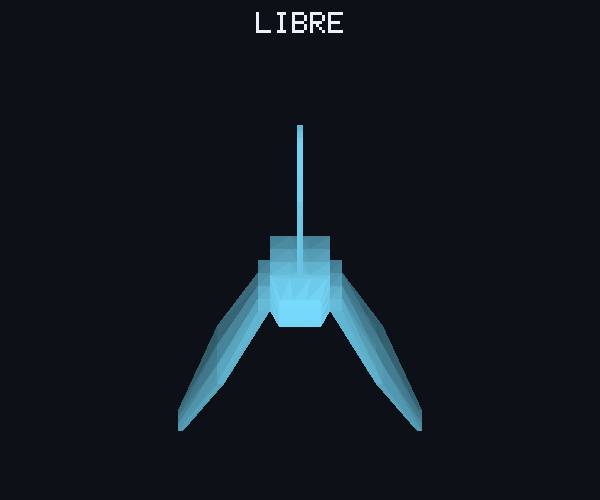
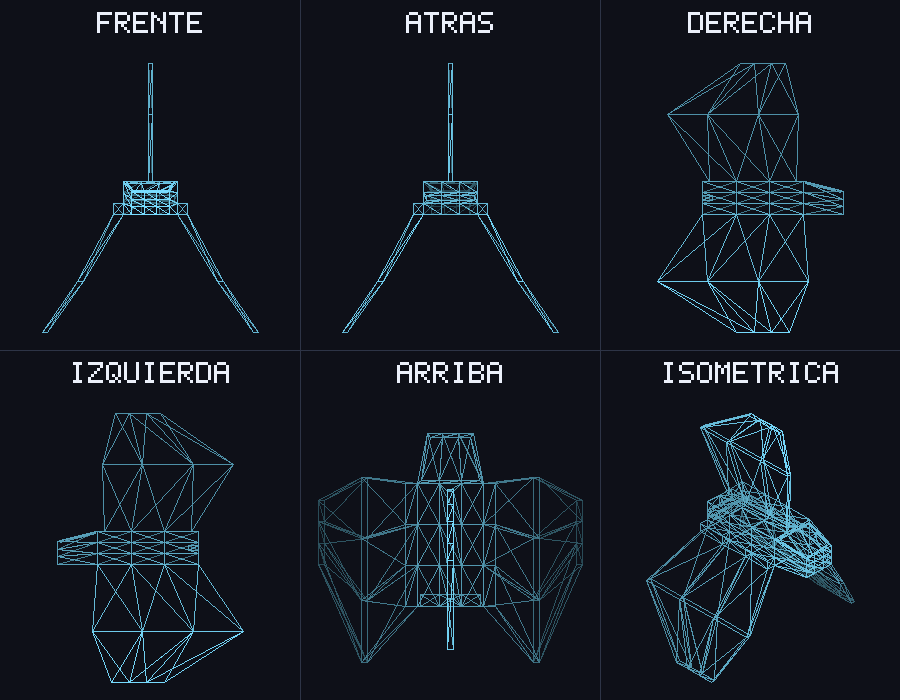
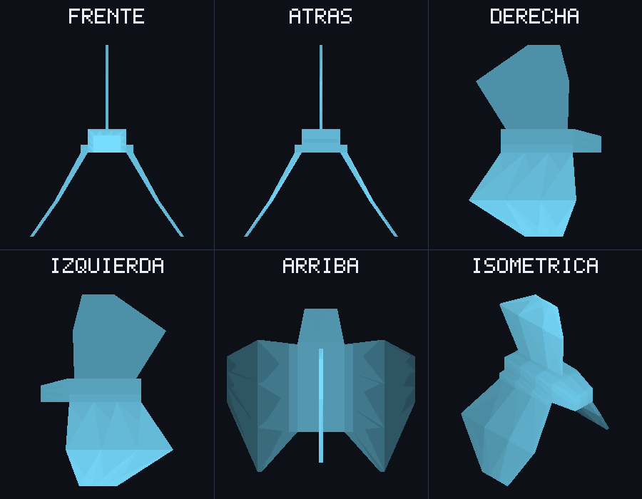
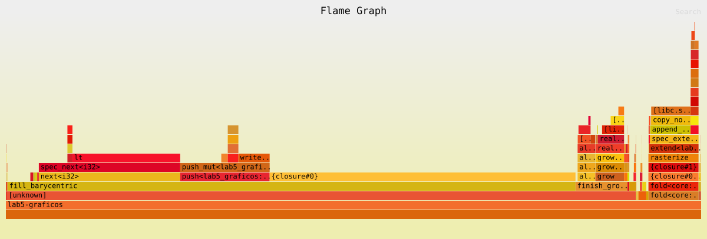

# Lab 5 — Rellenar triángulos

Rasterizador por software en Rust que carga un modelo OBJ (`assets/Nave_Javier_Alvarado.obj`), lo
proyecta desde varias vistas y genera los fragmentos de cada triángulo con tres modos:

```rust
#[derive(Clone, Copy)]
pub enum TriangleMode {
    Wireframe,          // contorno: tres llamadas a Bresenham
    FilledBarycentric,  // relleno con coordenadas baricéntricas
    FilledScanline,     // relleno por líneas horizontales
}
```

`rasterize(&triangles, mode)` devuelve un `Vec<Fragment>` y no toca el framebuffer, así que se puede
cambiar de algoritmo sin modificar el ensamblaje de primitivas ni el procesamiento de fragmentos.



## Cómo correrlo

```bash
cargo run --release                                   # ventana interactiva
cargo run --release -- --mode=scanline                # arrancar en un modo concreto
cargo run --release -- --screenshot                   # capturas/<modo>.png de los tres modos
cargo run --release -- --gif                          # rotacion.gif (relleno baricéntrico por defecto)
cargo run --release -- --benchmark-triangles          # mediciones, sin abrir ventana
cargo flamegraph -- --benchmark-triangles --mode=barycentric   # perfil de un solo algoritmo
cargo test --release                                  # pruebas de los dos rellenos
```

Controles de la ventana:

| Tecla | Acción |
|---|---|
| `0` / `Tab` | Cuadrícula con seis vistas |
| `1`–`7` | Frente, atrás, izquierda, derecha, arriba, abajo, isométrica |
| Flechas | Rotar libremente |
| `W` / `B` / `S` | Contorno / baricéntrico / scanline |

## Estructura

| Archivo | Contenido |
|---|---|
| `src/raster.rs` | `TriangleMode`, `Fragment`, `rasterize`, Bresenham, los dos rellenos y sus pruebas |
| `src/bench.rs` | Modo `--benchmark-triangles`: mediciones con `Instant` y `black_box` |
| `src/framebuffer.rs` | Framebuffer RGBA propio, `draw_fragments` y texto de 5x7 |
| `src/obj.rs` | Cargador de OBJ (triangula caras en abanico) |
| `src/main.rs` | Proyección de vistas, ventana con raylib, capturas y GIF |

## Imágenes de cada modo

| Contorno (`wireframe`) | Baricéntrico | Scanline |
|---|---|---|
|  |  |  |

Los triángulos se dibujan de lejos a cerca (algoritmo del pintor) y su color se oscurece con la
profundidad para que se distinga la forma. `capturas/barycentric.png` y `capturas/scanline.png` son
idénticas byte por byte (`cmp` no encuentra diferencias).

## Algoritmos

Los vértices están en píxeles enteros y el centro del píxel `(x, y)` es `(x + 0.5, y + 0.5)`. Ambos
rellenos trabajan solo con enteros (coordenadas duplicadas para que el `+0.5` sea exacto), así que no
hay errores de redondeo en los bordes.

**Regla de bordes (top-left, la misma que usan las GPU).** Un centro que cae exactamente sobre una
arista cuenta solo si es una arista superior (horizontal) o izquierda. En la práctica:

- una fila `y` se dibuja si su centro está en `[y_mín, y_máx)`;
- dentro de la fila, un píxel se dibuja si su centro está en `[x_izq, x_der)`.

Con esto, una arista compartida por dos triángulos la dibuja exactamente uno de los dos: no hay huecos
ni fragmentos duplicados.

### 1. Coordenadas baricéntricas (`fill_barycentric`)

1. Se calcula el doble del área con signo. Si es 0 (vértices colineales o repetidos) el triángulo es
   degenerado y se devuelve un `Vec` vacío, sin dividir entre cero.
2. Si el área es negativa se intercambian dos vértices, así que invertir el orden no hace desaparecer el
   triángulo.
3. Se recorre el rectángulo envolvente y para cada centro se evalúan las tres funciones de borde
   `w0, w1, w2` (los pesos baricéntricos sin dividir entre el área). El píxel está dentro si los tres son
   positivos, o si alguno es 0 y esa arista es superior/izquierda.

### 2. Líneas horizontales (`fill_scanline`)

1. Se ordenan los vértices por `y` (`v0`, `v1`, `v2`).
2. Para cada fila `y` en `[v0.y, v2.y)` se cruza la arista larga `v0→v2` con la corta (`v0→v1` si
   `y < v1.y`, si no `v1→v2`). `first_x` calcula con enteros el primer píxel cuyo centro queda a la
   derecha de cada cruce.
3. Se generan los píxeles de `[x_izq, x_der)`.

**Casos especiales:** una arista horizontal nunca se cruza, porque solo se usan aristas con
`y_inicio ≤ fila < y_fin`. Como cada fila se evalúa en su centro `y + 0.5` y los vértices tienen `y`
entera, un vértice nunca coincide con el centro de una fila: el cambio de arista corta en `v1` no deja
huecos ni repite filas. Tres vértices colineales dan dos cruces iguales y un tramo vacío.

## Comprobación de resultados

`cargo test --release` corre 13 pruebas (todas pasan). `check_same` compara el **conjunto de posiciones**
generado por los dos algoritmos con las 6 permutaciones de los vértices y verifica que no haya fragmentos
repetidos.

| Caso pedido | Prueba |
|---|---|
| Triángulo pequeño y grande | `triangulo_pequeno`, `triangulo_grande` (el número de fragmentos difiere del área en < 1 %) |
| Borde horizontal | `borde_horizontal` (arriba: se dibuja), `borde_horizontal_abajo` (abajo: no se dibuja) |
| Borde vertical | `borde_vertical` (izquierdo: se dibuja), `borde_vertical_derecho` (derecho: no se dibuja) |
| Orden inverso | `orden_inverso_no_desaparece` y las permutaciones de `check_same` |
| Parcialmente fuera del framebuffer | `parcialmente_fuera_del_framebuffer` (fragmentos con coordenadas negativas y mayores que la imagen; `put_pixel` los recorta) |
| Tres vértices colineales | `vertices_colineales` (incluye vértices repetidos): ambos devuelven 0 fragmentos |
| Extra | `borde_compartido_sin_huecos_ni_duplicados` (rectángulo partido por una diagonal cubre exactamente `w·h` píxeles) y `triangulos_aleatorios_coinciden` (3000 triángulos al azar) |

**Diferencias encontradas en los bordes: ninguna.** Las únicas posiciones donde dos implementaciones
razonables pueden diferir son los píxeles cuyo centro cae exactamente sobre una arista. Si el
baricéntrico aceptara `w ≥ 0` incluiría todas las aristas, mientras que un scanline con tramos
`[x_izq, x_der)` excluye siempre la derecha: saldrían píxeles de más en el borde derecho e inferior y
fragmentos duplicados entre triángulos vecinos. Por eso ambos usan la misma regla top-left: en el
baricéntrico, `w == 0` cuenta solo si la arista es superior o izquierda; en el scanline, filas y columnas
son intervalos semiabiertos. Con esa regla las posiciones coinciden en todos los casos probados.

El contorno sí cubre píxeles distintos al relleno: Bresenham incluye los dos extremos y los píxeles más
cercanos a la línea, aunque su centro quede fuera del triángulo (por ejemplo, en las aristas derecha e
inferior).

## Mediciones

`cargo run --release -- --benchmark-triangles`. Solo se mide `rasterize` (generación y almacenamiento de
fragmentos); quedan fuera la textura, la ventana y las esperas. Cada valor es la **mediana de 11
mediciones**, cada una con suficientes ejecuciones para durar ~150 ms; las entradas y salidas pasan por
`black_box`. Máquina: WSL2, 24 hilos (se ejecuta en uno).

| Carga | Triángulos | Modo | Fragmentos | Tiempo por ejecución | ns por fragmento |
|---|---:|---|---:|---:|---:|
| nave, vista isométrica 900x700 | 364 | wireframe | 54898 | 144.27µs | 2.63 |
| nave, vista isométrica 900x700 | 364 | barycentric | 315806 | 1.79ms | 5.67 |
| nave, vista isométrica 900x700 | 364 | scanline | 315806 | 529.97µs | 1.68 |
| nave, cuadrícula de 6 vistas | 2184 | wireframe | 158128 | 500.95µs | 3.17 |
| nave, cuadrícula de 6 vistas | 2184 | barycentric | 341214 | 1.90ms | 5.58 |
| nave, cuadrícula de 6 vistas | 2184 | scanline | 341214 | 792.31µs | 2.32 |
| 2000 triángulos pequeños (~8 px) | 2000 | wireframe | 27836 | 253.15µs | 9.09 |
| 2000 triángulos pequeños (~8 px) | 2000 | barycentric | 9437 | 228.13µs | 24.17 |
| 2000 triángulos pequeños (~8 px) | 2000 | scanline | 9437 | 155.18µs | 16.44 |
| 40 triángulos grandes (~400 px) | 40 | wireframe | 23054 | 40.01µs | 1.74 |
| 40 triángulos grandes (~400 px) | 40 | barycentric | 530616 | 1.82ms | 3.43 |
| 40 triángulos grandes (~400 px) | 40 | scanline | 530616 | 685.24µs | 1.29 |

Los dos rellenos producen **el mismo número de fragmentos** en todas las cargas, así que la comparación de
tiempo es justa. Trabajo que hace cada uno:

| Carga | Fragmentos (relleno) | Píxeles evaluados por baricéntrico | Aprovechamiento | Filas recorridas por scanline |
|---|---:|---:|---:|---:|
| nave, vista isométrica 900x700 | 315806 | 1457645 | 22 % | 20378 |
| nave, cuadrícula de 6 vistas | 341214 | 1569806 | 22 % | 52449 |
| 2000 triángulos pequeños (~8 px) | 9437 | 30834 | 31 % | 7864 |
| 40 triángulos grandes (~400 px) | 530616 | 1532421 | 35 % | 8177 |

**Resultado:** scanline es entre **1.5x y 3.4x más rápido** que el baricéntrico.

- El baricéntrico evalúa todo el rectángulo envolvente: solo el 22–35 % de los píxeles probados termina
  siendo fragmento, y cada prueba cuesta tres funciones de borde. Los triángulos de la nave son largos y
  delgados (mucho rectángulo vacío), por eso ahí la diferencia es mayor (3.4x).
- Scanline hace dos divisiones por fila y después solo un bucle de `push`; su costo crece con los
  fragmentos generados, no con el área del rectángulo.
- Con triángulos pequeños la ventaja baja a 1.5x: hay pocos fragmentos por triángulo y domina el costo fijo
  (crear un `Vec` por triángulo, ordenar vértices, copiar al resultado), por eso los ns por fragmento se
  disparan en ambos.
- En triángulos pequeños el contorno genera **más** fragmentos que el relleno (27836 vs 9437): el perímetro
  pesa más que el área.

## Perfil

Generado con `cargo flamegraph -- --benchmark-triangles --mode=<modo>` (con `debug = true` en
`[profile.release]` para tener nombres de funciones). Las funciones de relleno llevan `#[inline(never)]`
para que aparezcan como bloque propio.

- [perfil/flamegraph_barycentric.svg](perfil/flamegraph_barycentric.svg)
- [perfil/flamegraph_scanline.svg](perfil/flamegraph_scanline.svg)
- [perfil/flamegraph_wireframe.svg](perfil/flamegraph_wireframe.svg)



Proporción de muestras (ancho del bloque) de lo más relevante:

| Modo | Cálculos geométricos | Crear fragmentos (`push`) | Crecimiento del `Vec` (`finish_grow`/`realloc`) | Copia al resultado (`rasterize` → `extend`) |
|---|---:|---:|---:|---:|
| barycentric | ~69 % (`fill_barycentric` sin `push`: prueba de dentro/fuera 44 %, avance del rango 20 %) | 13 % | 7 % | 7 % |
| scanline | ~19 % (`first_x`, casi todo en `div_euclid`: 15 %) | 28 % | 13 % | 14 % |
| wireframe | ~34 % (`bresenham` sin `push`) | 20 % | 31 % | 8 % |

- **Baricéntrico:** el tiempo se va en la geometría. La mayoría de las evaluaciones de las funciones de
  borde son para píxeles que quedan fuera, así que es trabajo desperdiciado.
- **Scanline:** la geometría pesa poco; casi todo el tiempo es memoria: crear fragmentos, hacer crecer el
  `Vec` de cada triángulo y copiarlo al `Vec` final. La única operación geométrica visible es la división
  entera de `first_x`.
- **Contorno:** cada triángulo produce pocos fragmentos, así que el crecimiento del `Vec` (realloc
  repetidos desde capacidad 0) llega a ser casi un tercio del tiempo.

Posibles mejoras que señala el perfil: reservar capacidad (`Vec::with_capacity`) o escribir directamente en
un único `Vec` de salida en lugar de uno por triángulo, y en el baricéntrico evaluar las funciones de borde
de forma incremental (sumando una constante al avanzar en `x`) y recortar el rectángulo al framebuffer.

## Conclusión

Ambos rellenos generan exactamente las mismas posiciones gracias a una regla de bordes común y a la
aritmética entera. El baricéntrico es más sencillo y deja listos los pesos para interpolar atributos más
adelante, pero prueba muchos píxeles vacíos; el scanline solo recorre los píxeles que van a ser
fragmentos y por eso es de 1.5x a 3.4x más rápido en estas cargas. Una vez que la geometría es barata,
el cuello de botella pasa a ser la memoria (crear y copiar fragmentos).
